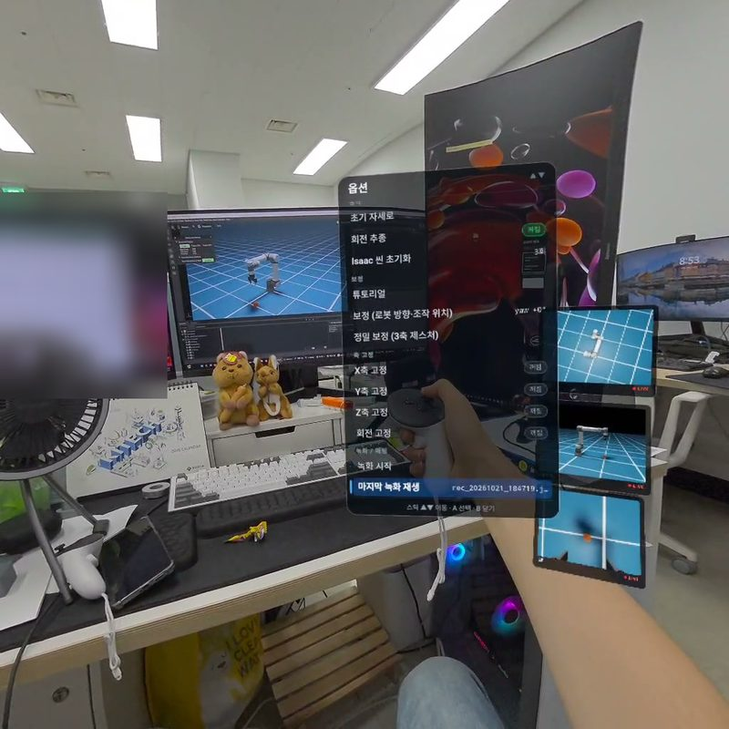
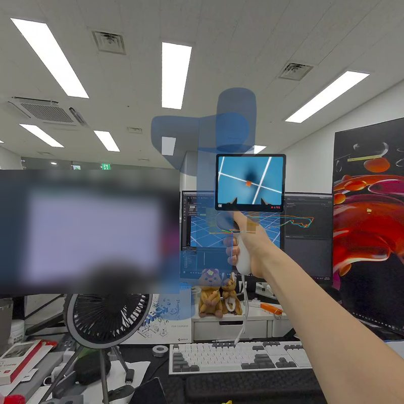
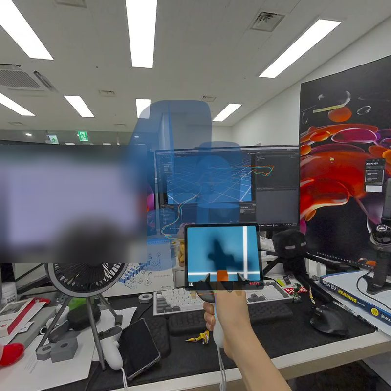
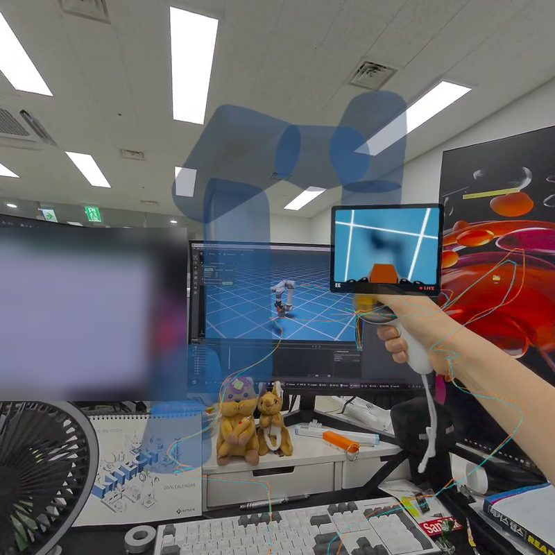

# Quest 3 → UR5e 텔레오퍼레이션

Meta Quest 3 컨트롤러로 UR5e를 실시간 조작한다. 헤드셋에 설치할 것은 없고, Quest 브라우저로 PC의 페이지를 열면
WebXR(패스스루 AR)로 바로 연결된다. 같은 브리지가 **Isaac Sim 4.2**(UR5e + Robotiq 2F-85), **URSim**, **실제 UR5e**(ur_rtde)를
모두 구동하므로, 시뮬레이터에서 익힌 조작·보정·녹화 파일을 실기에서 그대로 쓴다.

*Teleoperate a UR5e with a Meta Quest 3 over WebXR. One bridge drives Isaac Sim 4.2 (UR5e + Robotiq 2F-85 via RMPflow),
URSim and a real UR5e (ur_rtde servoL). Grip-clutch mapping, AR hologram of the robot, path lines, a world-space menu on the
controller, Isaac camera windows in the headset, recording/replay, calibration and safety limits.*

<p align="center">
  
  
</p>
<p align="center">
  
  
</p>

*Quest 3 패스스루에서 본 화면(2026-10-21, Isaac Sim 모드). 왼쪽 위부터: A 버튼으로 여는 옵션 메뉴와 실링/사이드/EE 카메라 창,
손에 맞춘 반투명 UR5e 홀로그램, EE 카메라를 보며 큐브 집기, TCP(하늘색)·손(주황) 경로.*

## 조작 한눈에

| 입력 | 동작 |
|---|---|
| 오른손 **그립** 쥐고 이동 | 로봇 TCP가 컨트롤러의 위치·회전을 따라온다(클러치·래칫: 놓았다 다시 쥐면 현재 TCP에서 재출발) |
| **트리거** | 그리퍼(아날로그) |
| **A** | 옵션 메뉴(헤드셋 착용 시, 컨트롤러 위에 패널이 뜬다; 스틱 ▲▼ 이동·A 선택·B 닫기) |
| **B** | 즉시 정지 / 메뉴 닫기 |
| 메뉴 | 초기 자세, Isaac 씬 초기화, 튜토리얼, 보정(로봇 방향·조작 위치, 3축 정밀), X/Y/Z/회전 고정, 녹화·재생, 이동 배율, 절대/상대 매핑, Isaac 카메라(실링·사이드·EE) 창, 시점, 홀로그램 맞추기/옮기기, 경로 지우기 |

헤드셋을 벗어도 그립 조작은 그대로 된다(헤드리스 모드, 메뉴는 잠김). 상세: [`docs/OPERATION.md`](docs/OPERATION.md).

```
 Quest 3 ──(1) WebXR 브라우저 ── wss JSON ──┐
         ──(2) oculus_reader APK ── adb ───┤──▶ bridge/teleop_bridge.py ──▶ Isaac Sim (TCP/JSON 서보 서버)
         ──(3) Unity 앱 ──────── ws JSON ──┘        (클러치·스케일·필터·     ──▶ URSim / UR5e (ur_rtde servoL 125 Hz)
                                                     작업공간 제한·안전)
```

| 입력 경로 | 개발자 모드 | 준비물 | 비고 |
|---|---|---|---|
| (1) **WebXR** (기본) | 불필요 | Quest 브라우저, 같은 LAN | 패스스루(AR)로 실제 로봇/모니터를 보며 조작. 가장 빠른 시작 |
| (2) **oculus_reader** | 필요 | USB-C, adb | 로봇학습 커뮤니티 표준(DROID 등). `third_party/oculus_reader`에 jborbik 포크를 둔다 |
| (3) **Unity** | 필요 | Unity 2022.3 + OpenXR | `unity/QuestTeleopStreamer.cs` |

## 설치

```powershell
git clone https://github.com/jeakun2/quest-ur5e-teleop.git
cd quest-ur5e-teleop
python -m venv .venv
.venv\Scripts\pip install -r requirements.txt
.venv\Scripts\python -m pytest tests -q        # 39 tests
```

Windows 기준으로 썼지만 브리지·웹 클라이언트는 Linux에서도 같다(`run.bat` 대신 같은 python 명령).
HTTPS 자체 서명 인증서는 첫 실행 때 `certs/`에 자동 생성된다. 방화벽에서 8765/TCP를 한 번 열어 둔다.

## A. Isaac Sim 4.2로 (로봇 없이 연습)

가이드: **[`docs/GUIDE_QUEST_ISAAC.md`](docs/GUIDE_QUEST_ISAAC.md)** (처음 쓰는 날 순서), 시뮬레이터 상세: [`docs/ISAAC_SIM.md`](docs/ISAAC_SIM.md)

```powershell
# 1) 시뮬레이터: UR5e + Robotiq 2F-85 + Lula RMPflow, 120 Hz 물리, 실링/사이드/EE 카메라
.venv\Scripts\python tools\isaac_sim.py            # numpy·scipy가 있는 Isaac 파이썬 환경(기본 conda `isaaclab`)으로 띄운다
#    창이 뜨고 로그에 READY / listening on 127.0.0.1:5560 이 찍히면 준비. 헤드리스는 --headless
# 2) 브리지
.venv\Scripts\python bridge\teleop_bridge.py --robot.type isaac
# 3) Quest 브라우저에서 https://<PC-IP>:8765 → 인증서 경고 "고급 → 계속" → Start AR
```

- Isaac 쪽 기능: 그리퍼(트리거), 씬 초기화(물리 발산 자동 감지·수동), 카메라 창(JPEG 8 Hz, 헤드셋 안 2D 창), 시점 프리셋,
  TCP 기준 좌표(툴 끝 +0.121 m), 시뮬 멈춤/재시작 시 브리지 자동 재접속.
- 상태 확인·명령: `tools\isaac_ctl.py status|reset|quit`, 스모크 테스트 `tools\smoke_test.py 8765`, 헤드리스 Chromium 검사 `tools\web_check.py`.

## B. 실제 UR5e로

가이드: **[`docs/GUIDE_QUEST_REAL_ROBOT.md`](docs/GUIDE_QUEST_REAL_ROBOT.md)** (안전 수칙·첫날 순서), 로봇 설정: [`docs/UR5E_SETUP.md`](docs/UR5E_SETUP.md)

```powershell
# PolyScope를 Remote 모드로, 로봇 IP 확인 후 (처음엔 느리게)
.venv\Scripts\python bridge\teleop_bridge.py --robot.type ur_rtde --robot.ip 192.168.1.10 ^
    --robot.speed_slider 0.3 --mapping.pos_scale 0.5
# Robotiq 그리퍼(URCap 소켓 63352)는 config.yaml의 gripper 항목
```

- 로봇 없이 먼저 URSim(도커)으로: `tools\ursim_up.ps1` 뒤 `--robot.type ur_rtde --robot.ip 127.0.0.1 --robot.auto_power true`.
- 처음 쓰는 자리에서는 보정을 한 번(헤드셋 메뉴 → 보정, 또는 `bridge\calibrate_frame.py`). 저장값은 `bridge\config.yaml`.
- 시뮬에서 녹화한 `runs\rec_*.jsonl`은 실기에서도 재생된다(시작점까지 속도 제한 안에서 접근한 뒤 재생).

## 안전 장치 (`bridge/mapping.py`, `teleop_bridge.py`)

- 그립을 놓거나(< 0.5), 트래킹이 끊기거나, 0.3 s 동안 새 샘플이 없거나, 메뉴가 열리면 `servoStop` 후 정지.
- 보호정지·비상정지·전원 꺼짐·시뮬 링크 끊김은 즉시 정지, 상태 `UNSAFE`.
- 주기당 이동량을 `max_lin_speed`(0.25 m/s)·`max_ang_speed`(1 rad/s)로 제한, 베이스 기준 박스(`workspace_min/max`)와
  반경(`max_reach` 0.85 m, `min_reach` 0.15 m) 안으로 클램프. 녹화 재생도 같은 제한을 받고 B로 즉시 멈춘다.
- 헤드셋을 벗은 상태(headless)에서는 메뉴를 무시해 더듬다 눌러도 모드가 바뀌지 않는다.

## 폴더

| 경로 | 내용 |
|---|---|
| `bridge/teleop_bridge.py` | 메인 루프. `--record` 세션 기록, `--source.type replay` 재생, 15 Hz 상태 푸시(관절·그리퍼·UI) |
| `bridge/mapping.py` | 클러치·스케일·회전 매핑·축 고정·상대/절대·EMA 필터·속도 제한·작업공간 클램프 |
| `bridge/session.py` | 착용 판정(headless/hmd), 메뉴, 튜토리얼·보정 흐름, 녹화/재생, 홀로그램 맞추기/옮기기, `cmd` 처리 |
| `bridge/trajectory.py` | 녹화 파일, TCP 궤적 재생기 |
| `bridge/sources/` | `webxr_source`(HTTPS+WSS, 카메라 프록시), `oculus_reader_source`(adb), `replay_source` |
| `bridge/robots/` | `ur_rtde_robot`(servoL), `isaac_robot`(소켓, 자동 재접속), `dummy_robot` |
| `bridge/gripper.py` | Robotiq URCap 소켓 그리퍼 / Isaac 그리퍼 |
| `bridge/config.yaml` | 모든 파라미터. CLI `--a.b value`로 덮어쓴다 |
| `isaac/ur5e_sim.py` | Isaac Sim 4.2: UR5e + 2F-85(robot_assembler) + RMPflow를 TCP/JSON 서보 서버로, 카메라 HTTP, 씬 리셋 |
| `web/` | WebXR 클라이언트(three.js r160): `ghost.js` 홀로그램·경로, `xrmenu.js` 월드 메뉴, `xrcams.js` 카메라 창, `monitor.html` PC 제어 페이지 |
| `unity/` | `QuestTeleopStreamer.cs` + 빌드 안내 |
| `tools/` | Isaac 런처·제어, URSim 도커, Quest 깨어있기(adb), QR 표시, 스모크/웹 검사, Wi-Fi·방화벽 스크립트 |
| `docs/` | 가이드 A/B, 조작, Isaac Sim, 메타 개발자 설정, UR5e 설정, 프로토콜(`PROTOCOL.md`) |

## 검증 기록

- 단위·E2E 테스트 39건(매핑·세션·궤적·Isaac 클라이언트·홀로그램·메뉴·WebXR 가짜 클라이언트→브리지→더미 로봇).
- URSim 5.26(도커): 스모크 테스트(hmd 판정→메뉴→축 고정→녹화 제스처→재생)와 데모 리플레이 통과.
- Isaac Sim 4.2: 같은 스모크 테스트 통과, 헤드리스 120 Hz·추종 오차 1~2 mm, 창 모드 20~30 Hz(공유 GPU), 그리퍼 정렬·EE 카메라 확인,
  헤드리스 Chromium으로 홀로그램 FK 오차 0.1 mm.
- **Quest 3 실기(2026-10-21)**: 패스스루 AR 세션(local-floor + DOM 오버레이) 접속, 메뉴·홀로그램·카메라 창·경로·그립 조작 확인(위 사진).
- 실제 UR5e는 아직 미연결. 연결 후 가이드 B의 순서대로.

## 라이선스

MIT. `web/vendor`의 three.js(r160)는 MIT, `third_party/oculus_reader`(저장소에 포함하지 않음, 별도 클론)는 Apache-2.0.
